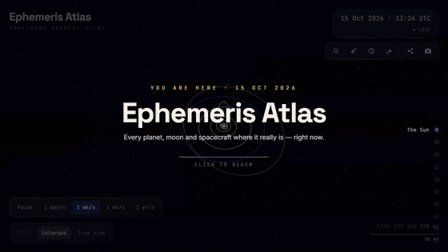

<div align="center">

# 🌌 Ephemeris Atlas

**Scroll from the Sun to the edge of the Local Group — in real time, at real positions.**

An immersive 3D atlas of the solar system and our galactic neighbourhood. Travel
outward past every planet, then pull back until the whole solar system is a dot
in the Milky Way. Tap anything for real facts — including a **live distance from
Earth** and how long its light takes to reach you.

[](https://react.dev)
[](https://www.typescriptlang.org)
[](https://threejs.org)
[](https://vite.dev)
[](https://tailwindcss.com)



</div>

---

## ✨ Why it's called *Ephemeris Atlas*

An **ephemeris** is a table of where celestial bodies actually are at a given
instant. That's the heart of this project: nothing here is a decorative loop of
spinning spheres — every body is placed where it really is, right now (or at any
moment you travel to).

## 🔭 Features

| | |
|---|---|
| 🌙 **Tonight's sky** | Allow location (or type coordinates) to see which planets are up tonight, how high, which way to look, rise/set times and whether you need binoculars — with a mini sky chart. |
| ⏳ **Time travel** | Date scrubber (±10 years) and one-tap jumps to the next lunar & solar eclipse, Mars / Jupiter / Saturn opposition, planetary conjunctions, Venus's greatest elongation and Full / New Moon. |
| 🔗 **Shareable links** | `?t=2027-08-02&focus=mars&scale=true` opens exactly that moment and view. The Share button copies the current one; the camera button saves a PNG. |
| 📖 **Story mode** | A short caption at every stop — why Venus spins backwards, why Uranus rolls on its side, how Neptune was found with maths. |
| ⚖️ **Compare** | Your weight on every world, day and year lengths, and a true-scale size strip. |
| 🔎 **Search & keys** | `⌘K` / `Ctrl K` / `/` to find any body; `←` `→` / `Space` / `PgUp` `PgDn` step through the tour; `Esc` closes. |
| 📱 **Mobile** | Tap any body to fly to it; facts open in a bottom sheet; tour stops become a swipeable chip strip. |

## 🪐 What's real

| | |
|---|---|
| **Planets, Moon, Pluto** | Heliocentric positions from [`astronomy-engine`](https://github.com/cosinekitty/astronomy) in the J2000 ecliptic frame — fully client-side, arc-second accurate. Orbits are traced from the same ephemeris. |
| **Jupiter's moons** | Io, Europa, Ganymede and Callisto from `JupiterMoons()`. |
| **Ceres, Vesta, Pallas, Halley** | Propagated with a Kepler solver from their real [JPL Small-Body Database](https://ssd.jpl.nasa.gov/tools/sbdb_lookup.html) orbital elements — Pallas's 34.9° tilt and Halley's backwards orbit included. |
| **Voyager 1 · JWST** | Voyager 1 on its outbound heading (~1 light-day out in late 2026, linear fit to NASA/JPL telemetry); JWST at Sun–Earth L2. |
| **Light & shadow** | The Sun is the only light, so Earth's day/night line (and its city lights) are where they truly are. Saturn's shadow falls on its rings and the rings shade the planet. |
| **Motion & spin** | Real sidereal rotation periods — Venus's and Uranus's retrograde spin, Uranus's 98° tilt. Clouds and spin follow simulation time, so *Pause* stops everything. |
| **The Milky Way** | The Sun sits ~26,000 ly from the centre in an outer arm, and the galactic disc is tilted ~60° to the planets' orbits (from the real galactic pole direction). |
| **Textures & facts** | Maps from [Solar System Scope](https://www.solarsystemscope.com/textures) (CC BY 4.0); figures from [NASA fact sheets](https://nssdc.gsfc.nasa.gov/planetary/factsheet/). |

## 📏 Scale — an honest note

True size *and* true distance cannot share one frame (Neptune is 30 AU out;
planets would be invisible specks). So:

- **Distances are always real** — every body sits at its true relative AU.
- **Sizes** use two modes, toggled in the HUD:
  - **Enlarged** *(default)* — bodies keep their true size ratios to each other;
    the Sun is clamped so it doesn't swallow the inner planets, and moons are
    shown on compressed orbits next to their planets.
  - **True size** — real radius-to-distance proportion. The camera flies right
    up to each (now tiny) world and screen-space labels mark everything else,
    which reveals how staggeringly empty space really is.
- **Local Group** — on the way out the solar system shrinks to its true size
  against the galaxy while a live counter and scale bar sweep from AU to
  millions of light-years. Neighbour galaxies sit in their **true sky
  directions** at compressed distances; real distances are in their info cards.

## 🎮 Controls

| Input | What it does |
|---|---|
| **Scroll** / `↑` `↓` `Space` | Fly the guided tour: Sun → planets → Pluto → Local Group |
| **Click / tap** | Fly to any body and open its facts |
| **Hover** (desktop) | Quick fact card |
| **Right rail** / chips on mobile | Jump straight to any stop |
| **Bottom-left** | Simulation speed (pause → 1 yr/s) and size scale |
| **Top-right** | Simulated UTC clock, tools (Search · Tonight · Time travel · Compare), Share, Screenshot |

`prefers-reduced-motion` is respected: the simulation starts paused, the camera
doesn't drift and the intro sweep is skipped.

## 🚀 Getting started

```bash
git clone https://github.com/neeelbhavsar/ephemeris-atlas.git
cd ephemeris-atlas
npm install
npm run dev      # dev server
```

```bash
npm run build    # type-check + production build
npm run preview  # serve the production build
npm run lint     # oxlint
```

Deploys as a static site — `vercel.json` is included (`vercel deploy`), and any
static host serving `dist/` works.

## 🛠️ Stack

React 19 · TypeScript · Vite · **three.js / @react-three/fiber / drei /
postprocessing** · **astronomy-engine** · zustand · framer-motion · Tailwind CSS

## 📂 Project layout

```
src/
  data/          solar-system, extra bodies, Local Group + the searchable catalog
  lib/           ephemeris, Kepler solver, galactic frame, sky & event search,
                 URL state, formatting
  three/         R3F scene: Sun, Planet3D, GalileanMoons, SmallBodies,
                 AsteroidBelt, NeighborGalaxies, CameraRig (scroll tour),
                 shaders (materials.ts), post effects, SimClock
  components/    2D overlays: HUD, TourNav, InfoPanel, HoverCard, ScaleBar,
                 StoryCaption, Intro, panels/ (Search, Tonight, Time, Compare)
  store.ts       zustand store (hover, selection, speed, scale, clock, panels)
```

## 🙏 Credits

- [astronomy-engine](https://github.com/cosinekitty/astronomy) — ephemeris math
- [JPL Small-Body Database](https://ssd.jpl.nasa.gov/) — asteroid & comet orbital elements
- [Solar System Scope](https://www.solarsystemscope.com/textures) — texture maps, incl. Earth at night (CC BY 4.0)
- [NASA planetary fact sheets](https://nssdc.gsfc.nasa.gov/planetary/factsheet/) — body data

<div align="center">
<sub>Built with curiosity about very large distances.</sub>
</div>
